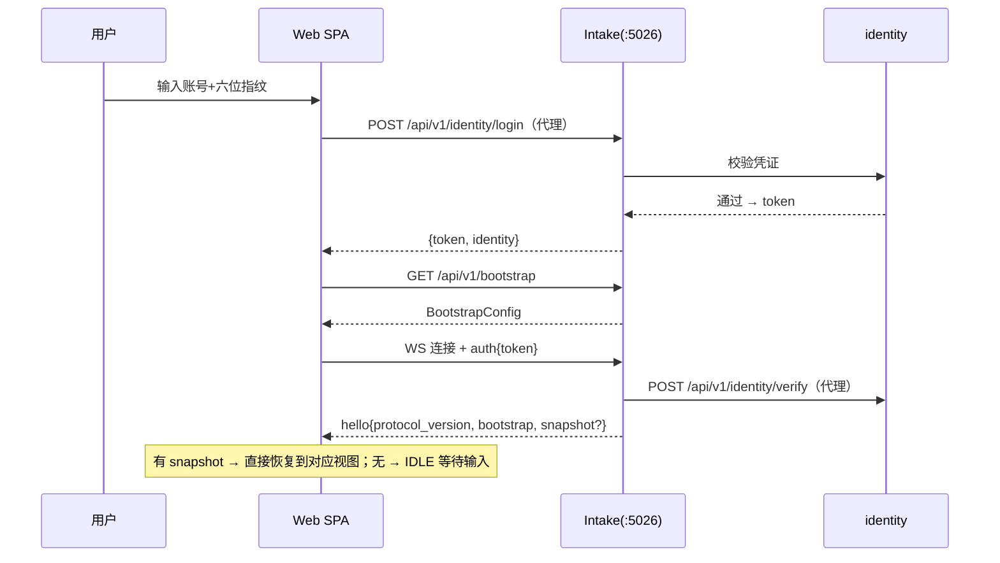
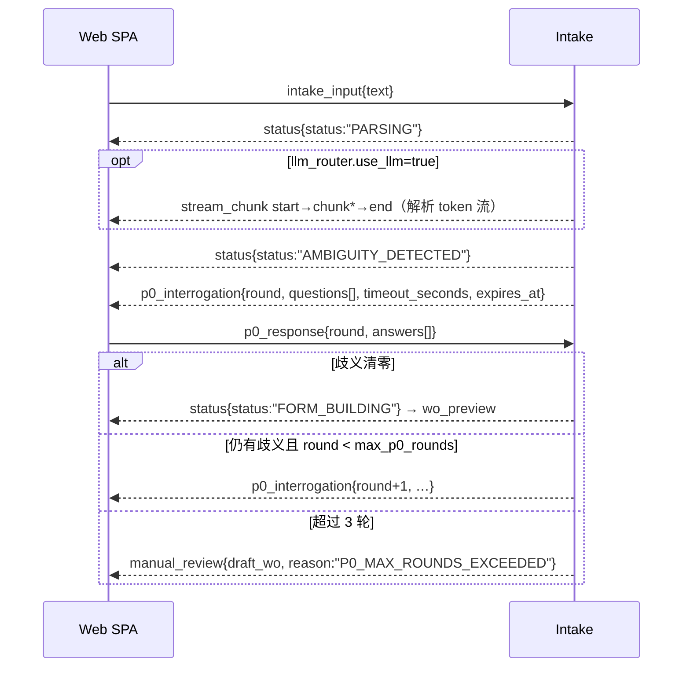
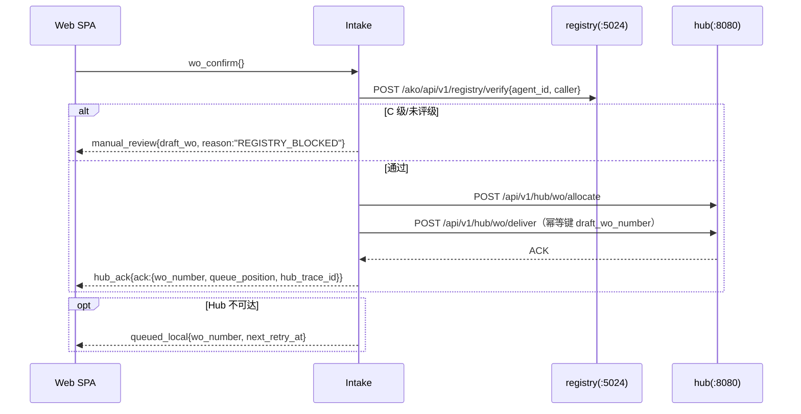

# AKO_hub_intake_agent 前端界面与前后端接口契约设计

> **文档定位**：本设计文档定义 AKO_hub_intake_agent 看板前端（纯 Web UI，暖金企业色系）的界面结构，以及前端与 FastAPI Intake 后端之间的接口协议与契约（WS v2 消息协议 + REST 端点 + 鉴权契约）。本设计是《AKO_hub_intake_agent_whitepaper_v1.1.0.md》第六章 6.3/6.6、附录 A.5 在前端侧的落地深化，并移植《Codex_Desktop_技术复刻蓝皮书》中分片流式消息、快照同步、引导配置下发、通道白名单、主题切换等技术元素。
>
> **适用基准**：AKO_hub_intake_agent_whitepaper_v1.1.0.md（协议基准）、Codex_Desktop_技术复刻蓝皮书.md（逆向分析基准）、AKO_std_tech_maturity_v1.0.0.md（成熟度基准）。

---

## 第一章 设计目标与范围

### 1.1 已确认决策

| # | 决策点 | 结论 |
|---|---|---|
| D1 | 前端形态 | 纯 Web 看板（React 18 + TS + Vite + Zustand），不引入 Electron 桌面壳 |
| D2 | 协议风格 | 升级版 WS 信封 v2：zod/TS 判别联合类型化消息 + req_id 关联 + 快照/增量同步 + 分片流式帧 + REST 兜底 |
| D3 | 功能范围 | 完整 V1：intake 全流程 + 专家模式 + 断点续传 + 运维面板 + 预算软熔断横幅 + 人工审核队列视图 |
| D4 | 身份门禁 | 纳入登录 UI（AKO_identity_service）+ token 透传（白皮书 A.5 第一重） |

### 1.2 现状问题（本设计的修复对象）

| # | 问题 | 现状证据 | 本设计处置 |
|---|---|---|---|
| P1 | WS 契约前后端错配 | `app.py` 推送 LangGraph 原始 state 字典（无 `type` 字段）；前端 `parseServerMessage` 按 `type` 解析，所有消息被判为 error | 第三章 WS v2 信封全量重定 |
| P2 | 前端发送的消息后端不认识 | 前端发 `confirm_deliver`，`app.py` 仅处理 `intake_input`/`p0_response` | v2 入站白名单含 `wo_confirm`/`wo_edit`/`wo_discard` 等 |
| P3 | 专家模式未接入 | `ExpertPage` 提交按钮仅 alert 占位 | 专家模式经 `POST /api/v1/intake/sessions` 创建会话，复用 wo_confirm 链路 |
| P4 | 无放弃/续传入口 | S90/S95 状态机有定义，前端无对应操作 | `session_abandon`/`session_resume` + 会话列表页 |
| P5 | 队列统计仅 CLI | `cmd_queue` 只读 SQLite 打印 | `GET /api/v1/intake/queue/stats` 升为 HTTP |
| P6 | 端口配置冲突 | `config/intake_config.yaml` port 改 5027，与 `vite.config.ts` dev server 5027 撞车 | 附录 B 统一约定 |
| P7 | 无登录门禁 | 白皮书 A.5 三重门禁第一重未实现 | 3.6 鉴权契约 + LoginPage |
| P8 | 软熔断无前端呈现 | 7.6 预算软熔断仅后端概念 | `soft_break` 消息 + 全局横幅 + 强制专家模式 |

### 1.3 范围外

- 不做 Electron 壳（D1）；不做 Law_Vault 日志归档 UI（属后端职责，US-005 由后端写 600_生命周期/）；不做 hub/registry 的管理界面（US-004 Hub 无感）。

---

## 第二章 架构总览

```
┌─────────────────────────────────────────────────────────────┐
│  浏览器（纯 Web 看板 SPA，vite dev :5027，proxy → :5026）      │
│  React 18 + TS + Vite + Zustand（5 slice）                   │
│  ┌──────────┬──────────┬──────────┬──────────┬───────────┐  │
│  │ LoginPage │ IntakePage│ ExpertPage│SessionsPage│ OpsPage │  │
│  └────┬─────┴────┬─────┴────┬─────┴──────────┴─────┬─────┘  │
│       │ REST（引导/会话CRUD/评审/队列/身份代理）      │         │
│       │               WS v2（会话实时流，单连接复用） │         │
└───────┼──────────────────────────┼───────────────────┼────────┘
        ▼                          ▼                   ▼
┌─────────────────────────────────────────────────────────────┐
│  FastAPI Intake（:5026）— LangGraph S00~S95 唯一事实源        │
│  REST 层 + WS v2 处理器（消息白名单 + Pydantic 判别联合校验    │
│  + 按会话 seq 序号 + 快照投影 + 分片流发射器）                 │
└──────┬──────────────┬───────────────┬───────────────────────┘
       ▼              ▼               ▼
  identity(登录门禁)  hub(:8080)    registry(:5024)   knowledge(:8000)
```

**关键原则**：

1. **单一事实源**：后端 `IntakeState`（LangGraph）是唯一权威状态；前端只维护"投影镜像"，不做权威决策。
2. **版本化信封**：所有 WS 消息携带 `v: 2`，未来协议升级不破坏旧客户端识别。
3. **序号收敛**：服务端按会话分配单调递增 `seq`，客户端据此做乱序去重与 gap 检测，gap 即索取快照——与蓝皮书 shared-object 快照同步同等的最终一致保证。
4. **白名单边界**：入站消息类型白名单 + 双端 schema 校验（后端 Pydantic 判别联合 / 前端 zod discriminatedUnion），未知类型回 `error` 不崩溃——蓝皮书 preload 通道白名单的 Web 等价物。
5. **最小依赖**：前端不引入路由库、UI 库；视图切换由 Zustand `view` 枚举驱动。

---

## 第三章 前后端接口协议契约 v2（核心）

### 3.1 消息信封

所有 WS 双向消息统一信封：

```json
{
  "v": 2,
  "type": "p0_interrogation",
  "req_id": "req-<uuid>",
  "session_id": "sess-20260901-001",
  "seq": 42,
  "ts": "2026-09-01T10:35:00+08:00",
  "payload": {}
}
```

| 字段 | 方向 | 说明 |
|---|---|---|
| `v` | 双 | 协议版本，恒为 2；不匹配 → `error(PROTOCOL_VERSION_MISMATCH)` |
| `type` | 双 | 消息类型，须在 3.2 白名单内 |
| `req_id` | 双 | 可选。请求-响应关联：服务端对入站请求的应答消息回填相同 `req_id`（蓝皮书 transferId 思想的轻量等价） |
| `session_id` | 双 | 会话标识。`auth`/`ping` 阶段可为空 |
| `seq` | S→C | 服务端按会话单调递增的序号，从 1 起 |
| `ts` | S→C | 服务端时间戳 ISO8601 |
| `payload` | 双 | 各类型的判别联合负载（3.2） |

### 3.2 消息类型白名单

#### 3.2.1 入站（C→S，服务端白名单 + Pydantic 校验）

| type | payload | 状态机对应 | 说明 |
|---|---|---|---|
| `auth` | `{token: string}` | 连接建立 | 连接后首条消息（超时未发即断开）。令牌经 identity 校验后绑定会话身份 |
| `intake_input` | `{text: string}` | S00→S10 | 文本 10~2000 字符；超限回 `error(TEXT_TOO_LONG/TEXT_TOO_SHORT)` |
| `p0_response` | `{round: int, answers: [{qid, value}], conservative?: boolean}` | S30→S20 | `conservative: true` = 用户选择"按最保守策略处理"，触发 7.1 降级路径（US-002） |
| `wo_edit` | `{draft_wo: {部分字段}}` | S50 人工微调 | 回写后重跑 validate（S60）与 M07 评审（S22），再发 `wo_preview` |
| `wo_confirm` | `{}` | S22/S50→S70 | 确认投递：registry verify → allocate → deliver 三重门禁链路 |
| `wo_discard` | `{}` | →S90 | 放弃当前工单 |
| `session_resume` | `{session_id: string}` | 断点续传（8.4） | 服务端回 `session_snapshot` |
| `session_abandon` | `{}` | →S90 | 放弃整个会话 |
| `stream_ack` | `{stream_id: string, bytes: int}` | — | 分片流控确认（3.4） |
| `ping` | `{}` | — | 心跳（默认 30s 一次） |

#### 3.2.2 出站（S→C）

> `SessionState` = 白皮书 6.1 会话状态对象的 JSON 投影（`ako_intake/core/state.py` IntakeState TypedDict 序列化形态：`status`/`raw_input`/`intent_tree`/`ambiguity_report`/`clarification_log`/`pending_questions`/`draft_work_order`/`review_record`/`hub_ack` 等）。`Question`/`Ako1WorkOrder`/`ReviewRecord`/`HubAck` 同 `ako_intake/models.py` 与 `schemas/` 既有契约。

| type | payload | 说明 |
|---|---|---|
| `hello` | `{protocol_version: 2, server_time, session_id, snapshot?: SessionState, bootstrap: BootstrapConfig}` | 连接建立即发。蓝皮书 get-shared-object-snapshot + get-initial-sidebar-bootstrap 合一：`snapshot` 仅在存在可续传会话时携带 |
| `session_snapshot` | `{state: SessionState, seq: int}` | 全量快照（连接/续传/gap 修复时下发） |
| `status` | `{status: StatusCode, detail?: string}` | 轻量状态迁移通知（S10/S20/S60 等无独立负载的迁移） |
| `p0_interrogation` | `{round, questions: Question[], timeout_seconds, expires_at}` | S30 反问卡片 |
| `p0_timeout` | `{round: int}` | 单轮反问超时提醒（后端到点仍执行 7.1） |
| `wo_preview` | `{draft_wo: Ako1WorkOrder, confidence_score, review_record?, risk_flag?, actions: ["confirm","edit","discard"]}` | S50/S22 工单预览；`draft_wo` 出站前经 PII 脱敏 |
| `review_result` | `{review_record: ReviewRecord}` | M07 评审结果（独立于 wo_preview 推送，供 ReviewPanel 单独渲染） |
| `hub_ack` | `{ack: HubAck}` | S70 投递回执（正式编号/hub_trace_id/队列位置） |
| `queued_local` | `{wo_number, next_retry_at}` | S65 Hub 不可达入本地队列 |
| `manual_review` | `{draft_wo, reason}` | S85 入人工审核队列（附差异清单/降级原因） |
| `stream_chunk` | `{stream_id, kind: "start"\|"chunk"\|"end", data}` | 分片流帧（3.4） |
| `soft_break` | `{usage_percent, monthly_quota_tokens, active}` | 预算软熔断状态消息（7.6）：`active=true` 触发（升横幅 + 强制专家模式），`active=false` 解除（横幅清除 + 恢复入口） |
| `error` | `{code: ErrorCode, message: string}` | 见 6.1 错误码表 |
| `pong` | `{}` | 心跳应答 |

> **软熔断生命周期注记**：`soft_break` 是同一告警信号的双沿消息（`active` 区分触发/解除，非两个独立事件类型）。服务端在每个连接的入站消息响应尾部检测预算状态沿（进程级 `BudgetTracker.should_soft_break` + 每连接 latch），沿变化即下发；`session_id=""` 属全局运维信号，不触碰会话 seq 镜像。解除发生于：月配额上调（`set_quota` 后下条入站消息响应带 `active=false`）或进程重启加载新配额（经 `hello.bootstrap.budget.soft_break_active` 快照对账）。快照为对账事实源：新连接收到 `soft_break_active=false` 时无条件清除横幅。本文档表格即权威白名单，前后端须同版本生效。

#### 3.2.3 关键消息负载示例

```jsonc
// C→S 提交输入
{"v":2,"type":"intake_input","session_id":"","req_id":"req-a1","payload":{"text":"帮我看看报价模块最近的数据有没有问题"}}

// S→C 反问卡片（白皮书 6.3 契约的 v2 化）
{"v":2,"type":"p0_interrogation","session_id":"sess-…","seq":3,"ts":"…","payload":{
  "round":1,
  "questions":[
    {"qid":"q-1-action","field":"action","text":"您说的'看看'是指以下哪种动作？",
     "type":"single_choice","options":["审计","修复","查看状态"],"required":true},
    {"qid":"q-1-scope","field":"scope","text":"请明确范围（只动____，不动____）：",
     "type":"open","options":[],"required":true}
  ],
  "timeout_seconds":300,"expires_at":"2026-09-01T10:40:00+08:00"}}

// S→C 工单预览（scope 已脱敏）
{"v":2,"type":"wo_preview","session_id":"sess-…","seq":9,"ts":"…","payload":{
  "draft_wo":{"wo_number":"WO-DRAFT-20260901-001","module":"AKO_quote_agent",
    "action":"审计","scope":"只动报价数据校验逻辑，不动数据库结构",
    "rules":["不修改生产环境","Git版本控制","关键模块人工Review"],
    "prohibitions":["禁止直接修改生产数据库"],
    "deliverable":"输出审计报告，标注异常数据条目","deadline":"90分钟"},
  "confidence_score":0.95,
  "review_record":{"review_score":0.96,"structural_passed":true,"differences":[]},
  "risk_flag":"","actions":["confirm","edit","discard"]}}

// S→C 投递回执
{"v":2,"type":"hub_ack","session_id":"sess-…","seq":11,"ts":"…","payload":{
  "ack":{"status":"acknowledged","wo_number":"WO-HAI-20260901-089",
         "queue_position":3,"estimated_start":"…","hub_trace_id":"hub-trace-…"}}}
```

### 3.3 快照与序号机制（shared-object 等价）

- 服务端为每个会话维护 `seq` 计数器（进程内存，会话状态本身在 SQLite），每个 S→C 消息 `seq` 自增。
- 客户端镜像规则：
  1. `msg.seq <= last_seq` → 重复消息，丢弃；
  2. `msg.seq == last_seq + 1` → 应用；
  3. `msg.seq > last_seq + 1` → 检测到 gap，丢弃该消息并发 `session_resume` 索取 `session_snapshot`。
- `session_snapshot` 无条件接受：`last_seq = snapshot.seq`，整个镜像以快照重建。
- 断线重连（见 5.4）与用户点击"恢复会话"均走同一 `session_resume` 通道。
- **设计决策说明**：增量同步采用"领域化类型事件"（每次状态迁移一个专门消息类型，消息即 diff），不引入 RFC 6902 通用 JSON Patch——状态机迁移是已知有限集，通用 patch 引擎属过度设计（YAGNI）；`seq` + 快照兜底已提供与蓝皮书 shared-object 相同的最终一致保证。

### 3.4 分片流式帧（蓝皮书 chunked-message-v1 移植）

- 用途：M01 LLM 增强解析（`llm_router.use_llm=true` 时）的 token 流输出；长负载分段下发。
- 帧序列：一个 `stream_id` 对应 `start → chunk* → end`，缺序即丢弃整个流。
  - `start`: `{stream_id, kind:"start", data:{total_bytes?, mime:"application/json", purpose:"parse"|"progress"}}`
  - `chunk`: `{stream_id, kind:"chunk", data:<字符串切片>}`
  - `end`: `{stream_id, kind:"end", data:{checksum?, final?: <最终解析对象>}}`
- 流控（对应蓝皮书 chunked-message-ack）：客户端每累计 16KB 发一次 `stream_ack {stream_id, bytes}`；服务端连续未收到 ack 时暂停发送，防止前端渲染积压。
- 蓝皮书增量 JSON 容器流（array-start/object-start/string-chunk/container-end）简化为 kind 三元组；intake 负载规模不需要容器级增量解析。
- 降级：`use_llm=false`（当前配置）时无 stream_chunk，ProgressStepper 以 `status` 事件为主驱动，流仅为增强。

### 3.5 REST 端点契约

#### 3.5.1 保留端点

| 方法 | 路径 | 说明 |
|---|---|---|
| GET | `/health` | 存活与依赖探测（hub/registry/identity/knowledge），负载不变 |
| GET | `/metrics` | 增强：在现有 snapshot 基础上并入 `budget`（usage_by_caller/usage_percent）与 `queue`（本地队列 stats） |
| GET | `/api/v1/intake/sessions/{id}` | 运行时状态查询（调试/对账） |
| POST | `/api/v1/intake/review` | M07 评审结果回写（`session_id`/`review_score`/`human_confirmed`），负载不变 |

#### 3.5.2 新增端点

| 方法 | 路径 | 说明 |
|---|---|---|
| GET | `/api/v1/bootstrap` | 引导配置（蓝皮书 bootstrap 端点等价物），响应见下 |
| GET | `/api/v1/intake/sessions` | 会话列表：非终态全量 + 最近 7 天终态，供续传选择页 |
| POST | `/api/v1/intake/sessions` | 创建会话：`{raw_text?}` 走自然语言链路（S00 起）；`{draft_wo?}` 走专家模式（跳过 S10~S30，直接以 draft_wo 进入 S50，随后 validate/review 后发 `wo_preview`）。响应 `{session_id, status}`。**（落成时补充端点，理由：专家模式需要会话创建入口，P3 修复）** |
| POST | `/api/v1/intake/sessions/{id}/abandon` | S90 放弃会话，响应 `{session_id, status:"ABANDONED"}` |
| GET | `/api/v1/intake/queue/stats` | 本地投递队列统计（由 CLI `cmd_queue` 升为 HTTP），响应 `{pending, done, failed}` |
| POST | `/api/v1/intake/queue/flush` | 手动冲刷本地队列（运维面板按钮），响应 `{flushed: [wo_number…]}` |
| POST | `/api/v1/identity/login` | 身份登录代理：`{account, fingerprint}` → identity service，响应 `{token, expires_at, identity:{account}}`。identity 地址未配置时返回开发态令牌（模拟通过，仅限非生产） |
| POST | `/api/v1/identity/verify` | 令牌校验代理：`{token}` → `{valid, identity}` |

#### 3.5.3 bootstrap 响应负载

```jsonc
{
  "agent_id": "AKO_hub_intake_agent",
  "version": "0.1.0",
  "terms": [{"term":"报价","module":"AKO_quote_agent","actions":["审计","修复","查看"]}],
  "intake": {"max_p0_rounds":3, "question_timeout_seconds":300,
             "max_questions_per_round":3, "review_score_threshold":0.9},
  "budget": {"soft_limit_percent":5.0, "monthly_quota_tokens":1000000,
             "usage_percent":1.2, "soft_break_active":false},
  "llm": {"use_llm":false, "simple":"qwen2.5-7b", "complex":"deepseek-v3"},
  "knowledge_enabled": true,
  "identity_required": true,
  "ws": {"heartbeat_seconds":30, "stream_ack_bytes":16384, "auth_timeout_seconds":10},
  "observability": {"sentry_dsn": ""}   // 蓝皮书 get-sentry-init-options 等价；空=不启用
}
```

> `budget.soft_break_active` 为软熔断对账事实源：新连接（含进程重启、配额恢复后）以此为准，`false` 时前端无条件清除横幅（与 3.2.2 生命周期注记一致）。

### 3.6 鉴权契约（白皮书 A.5 三重门禁的接口面）

| 门禁 | 接口面 | 后端动作 |
|---|---|---|
| 第一重 身份 | 登录页 → `POST /api/v1/identity/login` 换 token；REST 统一 `Authorization: Bearer <token>`；WS 首消息 `auth` | 后端经 `POST /api/v1/identity/verify` 代理校验（`gateways/identity_client.py` 扩展）；失败回 `error(AUTH_REQUIRED)` / HTTP 401；会话绑定 identity |
| 第二重 等级 | `wo_confirm` 链路内 | registry verify 拦 C 级/未评级目标（现有 `gateways/registry_client.py`），拦截结果以 `manual_review` 或 `error` 呈现 |
| 第三重 数据 | 出站负载 | `utils/pii.py` `mask_pii` 对 `wo_preview.draft_wo` 全字符串字段脱敏；含 PII 会话标记 `data_access_level`，前端展示"已脱敏"徽章 |

前端不接触 hub/registry 凭证，全部由后端代理（US-004 Hub 无感）。

---

## 第四章 前端界面设计

### 4.1 设计系统（暖金企业色系 tokens）

从现有内联样式（`App.tsx`）提炼为 CSS 变量体系，单文件 `web/src/styles/tokens.css`：

| token | 值 | 用途 |
|---|---|---|
| `--c-gold-grad` | `linear-gradient(90deg,#8a6d3b,#c9a227)` | 头部/主按钮渐变 |
| `--c-gold` / `--c-gold-dark` | `#c9a227` / `#8a6d3b` | 强调色/描边 |
| `--c-bg` | `#faf6ef` | 页面底色 |
| `--c-text` | `#3d2b1f` | 主文字 |
| `--c-border` | `#e5dcc8` | 分隔线/输入框边 |
| `--c-card` | `#ffffff` | 卡片底色 |
| `--c-success` | `#3e7d4f` | S70 投递成功 |
| `--c-warning` | `#b8860b` | S30 澄清中/提醒 |
| `--c-danger` | `#a33a2b` | S80 失败/错误 |
| `--c-review` | `#d97706` | S85 人工审核 |
| `--c-info` | `#4a6fa5` | S20/S60 信息 |
| 状态色带 | S10-S20 灰、S30 琥珀、S50 金、S22 紫、S65 橙、S70 绿、S80 红、S85 深琥珀 | ProgressStepper 状态色映射 |
| 间距/圆角 | 4/8/16/24 基准；卡片圆角 8px；字体 system-ui 栈 | 全局 |

深色模式：`html[data-theme="dark"]` class 切换 + token 覆盖（蓝皮书 `electron-dark/electron-light` 等价实现），选择持久化 localStorage，默认识别系统偏好。

### 4.2 视图结构（5 视图 + AppShell）

Zustand `useUiStore.view: "login" | "intake" | "expert" | "sessions" | "ops"` 枚举切换（不引入路由库，D 最小依赖原则；外链一律不放行——蓝皮书 will-navigate 白名单的 SPA 等价）。

| 视图 | 准入 | 职责 |
|---|---|---|
| LoginPage | 未登录 | 账号 + 六位指纹输入（A.5 第一重），错误提示，成功后进入 intake |
| IntakePage | 已登录 | 自然语言入口（唯一显性交互=输入框，US-001） |
| ExpertPage | 已登录 | ako1 八字段专家表单（预算软熔断时强制跳入，7.6） |
| SessionsPage | 已登录 | 非终态会话列表 → `session_resume` 断点续传（8.4） |
| OpsPage | 已登录 | 运维面板：依赖灯/指标/队列/预算用量条 |

### 4.3 组件规格

```
AppShell
├─ 头部：暖金渐变；logo + 视图导航 + 主题切换 + WS 连接状态点
│        （绿=open / 黄=reconnecting / 红=closed）+ 软熔断横幅插槽
├─ LoginPage
│  └─ 账号输入 + 六位指纹输入（pattern 校验）+ 登录按钮 + 错误提示
├─ IntakePage
│  ├─ InputComposer    textarea + 10~2000 字符计数（超限即时提示）
│  │                   + 提交/放弃按钮
│  ├─ ProgressStepper  PARSING→AMBIGUITY_DETECTED→CLARIFYING→FORM_BUILDING
│  │                   →VALIDATING→REVIEWING→终态 七段进度；
│  │                   驱动=status 事件为主、stream_chunk 为辅
│  ├─ QuestionCard     每轮 ≤3 问（白皮书 US-002）；单选(select)/填空(input)/
│  │                   确认(radio) 三型渲染；expires_at 倒计时；
│  │                   必答校验；"按最保守策略处理"按钮
│  │                   → p0_response{conservative:true}
│  ├─ WoPreviewCard    八字段表单化展示（module/action/scope/rules/
│  │                   prohibitions/deliverable/deadline）；置信度徽章 +
│  │                   review_score + 差异清单；编辑模式切换；
│  │                   PII"已脱敏"徽章；confirm/edit/discard 三按钮
│  ├─ ReviewPanel      review_score<0.9 时必现：展示评审记录 + 人工确认按钮
│  │                   → POST /api/v1/intake/review{human_confirmed:true}
│  ├─ DeliveryResultCard  hub_ack 渲染：正式编号 + hub_trace_id + 队列位置；
│  │                   queued_local/manual_review 对应提示态
│  └─ TranscriptPanel  澄清记录时间线（轮次/问/答/时间戳，US-005 可追溯）
├─ ExpertPage
│  └─ 八字段表单 + 客户端预校验（非空/scope PII 提示）→
│     POST /api/v1/intake/sessions{draft_wo} → WS 收 wo_preview → wo_confirm
├─ SessionsPage
│  └─ 会话列表（status 徽章 + updated_at）→ 点击恢复（session_resume）
└─ OpsPage
   ├─ HealthLights    /health 依赖灯（hub/registry/identity/knowledge）
   ├─ MetricsBoard    /metrics 10s 轮询：会话量/P0 轮次/投递成功率/Token 用量条
   └─ QueuePanel      queue/stats + 手动冲刷按钮（queue/flush）
```

### 4.4 Zustand store 设计（5 slice）

| store | 关键字段 | 动作 |
|---|---|---|
| `useBootstrapStore` | `bootstrap: BootstrapConfig \| null, loaded, error` | `load()` GET /bootstrap（AppShell 挂载时） |
| `useAuthStore` | `token, identity, status: "logged_out"\|"verifying"\|"logged_in"` | `login(account, fp)`、`logout()`（清 token + 断 WS） |
| `useSessionStore`（重构现有） | `sessionId, status, lastSeq, questions[], round, questionExpiresAt, draftWo, confidenceScore, reviewRecord, riskFlag, hubAck, queuedLocal, manualReview, transcript[], streamBuffer` | `applyMessage(env)` 按 3.3 镜像规则应用信封；`applySnapshot(state, seq)`；`reset()` |
| `useOpsStore` | `health, metrics, queueStats, lastFetched` | `poll()`（10s 轮询 /health /metrics queue/stats） |
| `useUiStore` | `view, theme, toasts[], softBreak, connection: "connecting"\|"open"\|"reconnecting"\|"closed"` | `setView/setTheme/toast/pushSoftBreak` 等 |

现有 `web/src/store/useSessionStore.ts` 与 `web/src/api/client.ts` 整体替换为上述设计（旧测试同步迁移）。

---

## 第五章 关键时序

### 5.1 登录与连接



### 5.2 澄清循环



### 5.3 确认投递（三重门禁）



### 5.4 断点续传与重连

- **主动续传**：SessionsPage 点击会话 → WS `session_resume{session_id}` → `session_snapshot` → 前端按 `status` 恢复视图：S30 重显反问卡、S50/S22 重显预览、S65 显示重试中、S85 显示人工审核态。
- **被动重连**：连接断开 → `connection:"reconnecting"`，指数退避 1s/2s/4s/8s…30s 封顶；重连成功 → 重新 `auth` → `hello`（含 snapshot）→ 对账。后端侧会话状态在 SQLite 持久化（已有 SessionStore），重启后 `list_non_terminal` 支撑续传（白皮书 8.4）。

---

## 第六章 错误处理与降级

### 6.1 错误码表

| code | 触发 | 前端处置 |
|---|---|---|
| `PROTOCOL_VERSION_MISMATCH` | `v` ≠ 2 | 弹维护提示，停止连接 |
| `INVALID_MESSAGE_TYPE` | 入站 type 不在白名单 | toast 提示，连接不中断 |
| `INVALID_PAYLOAD` | Pydantic 校验失败 | toast 提示 + 本地表单回滚 |
| `AUTH_REQUIRED` | 未 auth 即发业务消息 / token 失效 | 跳转 LoginPage |
| `SESSION_NOT_FOUND` | resume 的会话不存在 | SessionsPage 刷新列表 |
| `TEXT_TOO_SHORT` / `TEXT_TOO_LONG` | 文本 <10 / >2000 字符 | InputComposer 行内提示 |
| `P0_MAX_ROUNDS` | 超 3 轮仍未清零 | 展示 manual_review 卡片 |
| `P0_TIMEOUT` | 单轮超时 | 倒计时归零提示 + 展示降级结果 |
| `SCHEMA_ERROR` | 工单校验失败 | ReviewPanel 展示差异清单 |
| `HUB_UNREACHABLE` | Hub 不可达 | queued_local 卡片（S65） |
| `SOFT_BREAK_ACTIVE` | 预算软熔断中 | 全局横幅 + 强制专家模式 |
| `INTERNAL` | 未归类异常 | toast + 错误码回显 |

### 6.2 降级场景处置矩阵

| 场景 | 后端 | 前端 |
|---|---|---|
| WS 断开 | 会话状态已持久化 | 退避重连 + snapshot 对账 |
| P0 超时（300s） | 7.1 保守降级（审签 + 全局审计范围 + `risk_flag:"HIGH_AMBIGUITY"` + 人工审核队列） | 倒计时归零提示 + 展示 manual_review 卡片 |
| 预算软熔断 | 7.6 禁用大模型解析，不阻塞大门 | `soft_break(active)` 横幅亮/灭 + 禁用/恢复自然语言入口（hello 快照对账兜底） |
| 后端不可用 | — | bootstrap/health 失败 → 维护页（依赖灯展示） |
| Hub 不可达 | 7.2 本地 SQLite 队列 + 指数退避 | queued_local 卡片 + OpsPage 队列面板可见重试态 |
| PII 内容 | 出站前 mask_pii | "已脱敏"徽章 |
| 未知消息类型 | 白名单拦截回 error | 双端 zod/Pydantic 校验，异常消息入 console 与埋点 |

---

## 第七章 测试与验收

### 7.1 测试分层

| 层 | 工具 | 覆盖点 |
|---|---|---|
| 前端单测 | vitest + jsdom | store 镜像规则（seq 去重/gap 修复/快照重建）、zod 消息解析、组件渲染（QuestionCard 三型/倒计时、WoPreviewCard 编辑态）、现有 2 个测试文件迁移扩展 |
| 前端契约测 | vitest | zod schema 导出 JSON Schema 与 `schemas/*.json` 比对（见 7.2） |
| 后端单测 | pytest | WS v2 处理器：每类入站消息 + 白名单拒绝路径（未知 type 回 error）+ auth 超时断开 + seq 自增；新 REST 端点（bootstrap/sessions/abandon/queue）；现有 18 个测试文件回归 |
| 端到端（可选） | Playwright | 全链路（mock hub）：登录→输入→澄清→编辑→确认→ACK；断线重连恢复 |
| 契约双端 | schemas/ 目录 | 见 7.2 |

### 7.2 契约测试机制（FI-III-09）

`schemas/` 目录为单一事实源，新增两份 schema：

- `schemas/ws_message_v2.json`：WS v2 信封判别联合（全量消息类型）；
- `schemas/bootstrap_v1.json`：bootstrap 响应契约。

双端一致性验证：后端 Pydantic 模型 `model_json_schema()` 导出 ↔ 前端 zod `z.toJSONSchema()` 导出，测试比对关键字段与约束（数值 ge/le、枚举、required 列表；格式差异做归一化后比对）。现有 `intake_input_v1.json`/`intent_tree_v1.json`/`ako1_wo_v1.json`/`hub_ack_v1.json` 保留并纳入同机制。

### 7.3 验收标准映射（白皮书第十章）

| 验收项 | 目标 | 本设计支撑 |
|---|---|---|
| AC-11 首屏加载 | ≤1.5s | 单 CSS tokens 文件 + 无 UI 库依赖；bootstrap 单次拉取 |
| AC-13 反问卡渲染 | ≤200ms | WS 推送直达 store，无轮询 |
| AC-07 投递零丢失 | 0% | queued_local 卡片 + 本地队列可见（OpsPage） |
| AC-08 断点续传 | 100% | 5.4 快照对账机制 |
| AC-27 预算软熔断 | 触发告警并降级 | soft_break 消息 + 强制专家模式 |
| AC-17 凭证存储 | 无硬编码 | token 仅存内存（Zustand），不进 localStorage |

---

## 第八章 实施分期与改动清单

### 8.1 分期

| 阶段 | 内容 | 出口标准 |
|---|---|---|
| A 契约层 | 后端 WS v2 处理器 + bootstrap + 新 REST 端点 + schemas 契约测试 | 契约测试双端通过；旧前端可按契约 mock 开发 |
| B 前端骨架 | tokens.css + AppShell + LoginPage + bootstrap/auth 接入 | 登录→连接→hello 全通 |
| C intake 全流程 | InputComposer→ProgressStepper→QuestionCard→WoPreviewCard→ReviewPanel→DeliveryResultCard + wo_confirm 链路 | 端到端一张工单投递成功（mock hub） |
| D 完整 V1 | ExpertPage 接入 + SessionsPage 续传 + OpsPage + 软熔断/超时/重连 | AC-07/08/27 场景验证通过 |
| E 测试验收 | vitest 补全 + Playwright 可选 + 验收核对 | 第十章相关 AC 项通过 |

### 8.2 后端改动清单（文件级）

| 文件 | 改动 |
|---|---|
| `ako_intake/models.py` | 新增 WS 信封/各消息负载的 Pydantic 判别联合模型（与 schemas/ws_message_v2.json 对应） |
| `ako_intake/adapters/ws_protocol.py`（新） | WS v2 处理器：信封解析、入站白名单分派、auth 首消息与超时、seq 管理、快照构造、stream_chunk 发射器与流控 |
| `app.py` | WS 端点改用 ws_protocol；新增 3.5.2 全部 REST 端点；/metrics 并入 budget+queue（monitor.metrics_payload 已支持 budget 参数，接线即可） |
| `ako_intake/gateways/identity_client.py` | 扩展 login/verify 代理调用；未配置地址时返回开发态模拟（仅非生产） |
| `ako_intake/llm/budget.py` | 预算跃迁跟踪：新增 `set_quota`（配额上调 = 解除软熔断的唯一进程内途径） |
| `ako_intake/adapters/ws_protocol.py` | 软熔断生命周期发射：入站消息响应尾部沿检测（每连接 latch），发 `soft_break{active}` 全局消息 |
| `ako_intake/config.py` + `config/intake_config.yaml` | 新增 `ws` 段（heartbeat_seconds/stream_ack_bytes/auth_timeout_seconds）、identity 端点地址；端口统一见附录 B |
| `schemas/ws_message_v2.json`、`schemas/bootstrap_v1.json`（新） | 契约单一事实源 |
| `docs/API.md` | 更新为 v2 契约（与本文档第三章一致） |

### 8.3 前端改动清单（文件级）

| 文件 | 改动 |
|---|---|
| `web/src/api/ws.ts`（新，替换 client.ts） | 信封 + zod discriminatedUnion + 重连退避 + stream ack 流控 + 心跳 |
| `web/src/api/rest.ts`（新） | fetch 封装（Bearer 头/错误码映射/401 跳登录） |
| `web/src/schemas/`（新） | zod schema 定义（与 schemas/ 双端一致） |
| `web/src/styles/tokens.css`（新） | 4.1 设计系统 + data-theme 深色模式 |
| `web/src/store/`（5 slice） | 4.4 设计；替换 useSessionStore.ts |
| `web/src/components/` | 4.3 组件树全部组件 |
| `web/src/pages/` | LoginPage/IntakePage(重构)/ExpertPage(接入)/SessionsPage/OpsPage（新） |
| `web/src/App.tsx` | AppShell 化（导航/主题/连接状态/软熔断横幅） |
| `web/vite.config.ts` | WS/REST 地址环境变量化（`VITE_INTAKE_WS_URL` 等，默认沿用 proxy） |

### 8.4 已知风险

| # | 风险 | 对策 |
|---|---|---|
| R1 | 端口冲突：`intake_config.yaml` port=5027 与 vite dev 5027 撞车 | 附录 B 统一：后端 5026、前端 dev 5027（proxy 已配置）；Phase A 首日修正 |
| R2 | `use_llm=false` 时无 stream_chunk，进度体感弱 | ProgressStepper 以 status 事件为主驱动（设计已按此），LLM 启用后自动增强 |
| R3 | identity 未部署时登录链路空转 | `/login`/`/verify` 开发态模拟 + 部署清单显式检查（secrets.env 配 identity 地址） |
| R4 | Pydantic 与 zod 导出 JSON Schema 格式差异（如 $defs 引用方式） | 7.2 契约测试做归一化比对，比对目标锁定字段/约束/枚举 |
| R5 | 旧前端 4 消息类型（client.ts）与新后端不兼容 | 前端整体替换为 v2，不做兼容层（v 字段已留升级空间） |

---

## 第九章 蓝皮书元素落地对照

| 蓝皮书技术元素 | 本设计等价实现 | 位置 |
|---|---|---|
| `codex-host-chunked-message-v1` 分片流 + ack 流控 | `stream_chunk`（start/chunk/end）+ `stream_ack` 16KB 确认 | 3.4 |
| shared-object 快照同步（全量 + 增量） | `session_snapshot` + `seq` 序号 + 领域化类型事件 diff | 3.3 |
| `get-shared-object-snapshot` / `get-initial-sidebar-bootstrap` | `hello`（snapshot+bootstrap 合一）/ `GET /api/v1/bootstrap` | 3.2.2/3.5.2 |
| preload 通道白名单 + 手写类型守卫 | 入/出站消息白名单 + Pydantic 判别联合 / zod discriminatedUnion 双端校验 | 3.2 |
| `connect-app-host` MessageChannel port 直连 | 不适用（单页直连后端，无跨上下文）；等价物 = 单 WS 复用 + `req_id` 请求关联 | 3.1 |
| sandbox iframe 源锁定 + initId 校验 | SPA 无外链 + CSP + 服务端消息来源校验（Bearer 绑定会话） | 3.6 |
| 主题 class 切换（electron-dark/light） | `html[data-theme="dark"]` token 覆盖 | 4.1 |
| `get-sentry-init-options` 埋点初始化下发 | `bootstrap.observability.sentry_dsn` | 3.5.3 |
| will-navigate/will-redirect 导航白名单 | SPA 视图枚举（Zustand view）+ 外链不放行 | 4.2 |
| 鉴权头统一组装 + 会话分区 | Bearer token 透传 + identity 代理校验 + WS auth 首消息 | 3.6 |

---

## 第十章 白皮书符合性对照

| 白皮书条款 | 本设计落地 |
|---|---|
| 6.3 与看板前端的通信协议 | 第三章 v2 信封（p0_interrogation/p0_response/wo_preview 全保留并增强） |
| 6.6 可观测性与巡检接口 | 3.5 保留 /health /metrics（增强 budget+queue） |
| A.5 三重门禁 | 3.6 鉴权契约 + LoginPage + 脱敏徽章 |
| 7.1 连续澄清失败 | `p0_response.conservative` + `manual_review` 卡片 |
| 7.2 Hub 不可达 | `queued_local` + OpsPage QueuePanel |
| 7.6 预算软熔断 | `soft_break` 横幅 + 强制专家模式 |
| 8.4 断点续传 | 5.4 + SessionsPage |
| US-001 输入框为唯一显性交互 | IntakePage 设计 |
| US-002 每轮 ≤3 问 + 保守策略 | QuestionCard 规格 |
| US-003 工单可微调 + 确认 | WoPreviewCard 编辑模式 + wo_edit/wo_confirm |
| US-005 全链路可追溯 | TranscriptPanel 时间线（后端日志归档职责不变） |

---

## 附录 A 现状错配清单（修复对照）

| # | 现状 | 目标（本设计） |
|---|---|---|
| 1 | WS 推送原始 state 字典，无 `type` | 3.1/3.2 v2 信封与白名单 |
| 2 | 前端 `confirm_deliver` 后端不识别 | `wo_confirm` 入站消息 + 5.3 链路 |
| 3 | 前端 `parseServerMessage` 手写类型守卫且判定错误 | zod discriminatedUnion + 契约测试 |
| 4 | ExpertPage 提交未接入 | POST /api/v1/intake/sessions + wo_confirm 复用 |
| 5 | 无放弃/续传 UI | `session_abandon`/`session_resume` + SessionsPage |
| 6 | 队列统计仅 CLI | GET queue/stats + OpsPage |
| 7 | /metrics 无 budget/queue | 3.5.1 增强 |
| 8 | 无登录门禁 | LoginPage + 3.6 |
| 9 | 无软熔断/超时/重连前端逻辑 | 第六章处置矩阵 |

## 附录 B 端口与地址约定

| 服务 | 端口 | 说明 |
|---|---|---|
| Intake 后端 | **5026** | 与白皮书 6.6、docs/API.md 一致；`config/intake_config.yaml` 的 5027 在 Phase A 修正（R1） |
| 前端 dev server | 5027 | vite.config.ts 已配 /ws /api proxy → 5026，保持不变 |
| hub / registry / identity / knowledge | 8080 / 5024 / 按 secrets.env / 8000 | 仅后端出站，前端不直连 |

---

## 签章区

| 项目 | 内容 |
|:---|:---|
| 起草 | AKO_studio（2026-09-01） |
| 审签 | 待 AKO_studio 人工签章（禁止自动化） |
| 生效日期 | 待定 |
| 下次审阅 | 生效后 3 个月 |

---

> **文档结束**
>
> 本设计文档遵循AKO体系文档规范，作者AKO_studio，版本v1.0.0。
> 任何修改须通过AKO_build_agent的ChangeSet流程，经审计签入后方可生效。
